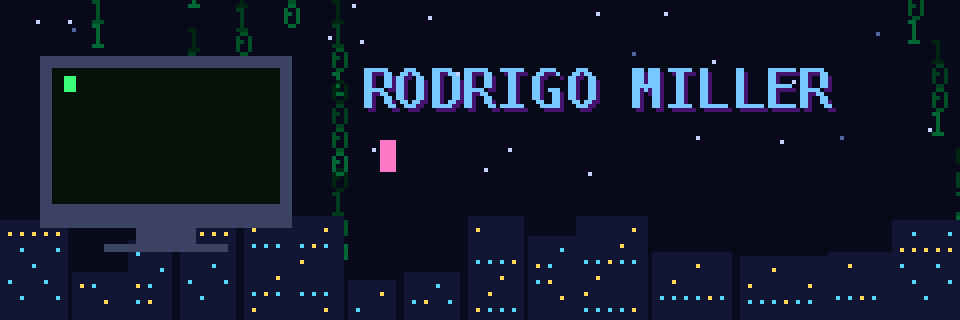

<!-- ====================== BANNER 8-BIT ====================== -->
<p align="center">
  
</p>

<!-- ====================== TÍTULO DIGITANDO ====================== -->
<p align="center">
  <a href="https://git.io/typing-svg">
    
  </a>
</p>

<p align="center">
  
  
  
</p>

<p align="center">
  <a href="https://www.linkedin.com/in/rodrigo-miller-170340233"></a>
  <a href="mailto:rodrigomiller.developer@gmail.com"></a>
  <a href="https://www.kaggle.com/rmiller021"></a>
  <a href="https://"></a>
</p>


## 🧑‍💻 Sobre mim

Sou **Analista e Desenvolvedor de Sistemas** e **desenvolvedor fullstack**, apaixonado por criar soluções criativas e resolver problemas complexos de forma analítica. Acredito que a tecnologia, usada de forma estratégica, pode transformar o mundo e facilitar nossas vidas.

Minha experiência une **Inteligência Artificial / Machine Learning**, com foco em **Visão Computacional**, e **desenvolvimento web** front-end e back-end. Sou movido por desafios e estou sempre aprimorando minhas habilidades.

```python
class RodrigoMiller:
    def __init__(self):
        self.role      = "Analista e Desenvolvedor de Sistemas"
        self.education = "ADS @ Universidade Católica de Pelotas (UCPel)"
        self.research  = "IA aplicada à detecção de tumores cerebrais"
        self.focus     = ["Machine Learning", "Deep Learning", "Visão Computacional", "Fullstack"]
        self.learning  = ["Next.js", "TypeScript", "Docker", "LLMs & RAG"]
        self.status    = "Aberto a novas oportunidades e colaborações 🚀"
```

<details>
<summary><b>🔬 Iniciação Científica — IA aplicada ao diagnóstico médico (clique para expandir)</b></summary>
<br>

Pesquisa em **Inteligência Artificial**, **Machine Learning** e **Deep Learning** aplicados à **Visão Computacional**, com foco na **detecção e classificação de tumores cerebrais** e no auxílio ao diagnóstico médico.

**Processamento de dados**
- Filtros de pré-processamento de imagens para otimização dos dados
- Normalização e análise exploratória, essenciais para o treinamento de modelos

**Algoritmos desenvolvidos**

| Machine Learning clássico | Deep Learning |
| :-- | :-- |
| SVM (Support Vector Machines) | Neural Networks |
| Logistic Regression | CNN (Convolutional Neural Networks) |
| Perceptron | Transfer Learning |
| Multilayer Perceptron | |

</details>


## 🛠️ Tech Stack

### 🤖 Inteligência Artificial & Data Science
<p>
  <a href="https://skillicons.dev"></a>
</p>
<p>
  
  
  
  
  
  
  
  
  
  
</p>

### 🎨 Front-end
<p>
  <a href="https://skillicons.dev"></a>
</p>

### ⚙️ Back-end & Bancos de Dados
<p>
  <a href="https://skillicons.dev"></a>
</p>
<p>
  <a href="https://skillicons.dev"></a>
</p>

### ☁️ DevOps & Cloud
<p>
  <a href="https://skillicons.dev"></a>
</p>

### 🧰 Ferramentas & Produtividade
<p>
  <a href="https://skillicons.dev"></a>
</p>


## 📊 Estatísticas no GitHub

<p align="center">
  
  
</p>

<p align="center">
  
</p>

<p align="center">
  
</p>

<p align="center">
  
</p>

<!-- Cobrinha comendo as contribuições: gerada pelo workflow .github/workflows/snake.yml -->
<p align="center">
  <picture>
    <source media="(prefers-color-scheme: dark)" srcset="https://raw.githubusercontent.com/rodrigomillerdev/rodrigomillerdev/output/github-snake-dark.svg" />
    <source media="(prefers-color-scheme: light)" srcset="https://raw.githubusercontent.com/rodrigomillerdev/rodrigomillerdev/output/github-snake.svg" />
    
  </picture>
</p>


## 🤝 Vamos conectar!

<p align="center">
  Fique à vontade para explorar meus projetos e contribuições.<br>
  <b>Estou sempre aberto a novas oportunidades e colaborações!</b>
</p>

<p align="center">
  <a href="https://www.linkedin.com/in/rodrigo-miller-170340233"></a>
  &nbsp;
  <a href="mailto:rodrigomiller.developer@gmail.com"></a>
</p>


