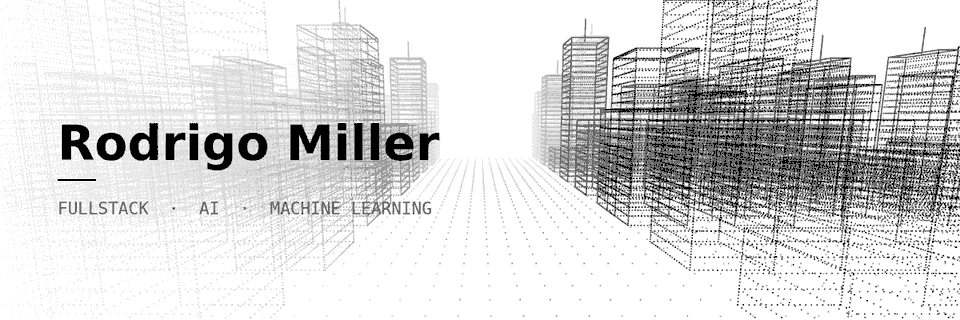

<picture>
  <source media="(prefers-color-scheme: dark)" srcset="./assets/hero-city-matrix.gif" />
  <source media="(prefers-color-scheme: light)" srcset="./assets/hero-city.gif" />
  
</picture>

<h3 align="center">Desenvolvo produtos completos, da interface ao back-end, e aplico IA onde ela resolve um problema real.</h3>

  Desenvolvedor Fullstack · <b>TypeScript, React, Node.js</b> · base em pesquisa de <b>Visão Computacional</b>

  

  
  
  
  

 

<table align="center">
  <tr>
    <td align="center" width="33%">ATUAÇÃO <b>Fullstack + IA aplicada</b></td>
    <td align="center" width="33%">STACK PRINCIPAL <b>TypeScript · React · Node.js · Python</b></td>
    <td align="center" width="33%">FORMAÇÃO <b>Análise e Desenv. de Sistemas — UCPel</b></td>
  </tr>
</table>

 

<table>
  <tr>
    <td width="55%" valign="top">
      
    </td>
    <td width="45%" valign="top">
      <h3>Opalite</h3>
      APP DESKTOP · LINUX E WINDOWS
      
<b>Problema:</b> notas, documentos, planilhas e slides ficam espalhados em apps diferentes, presos em formatos fechados e na nuvem de terceiros.

      
<b>Solução:</b> um único app local-first que edita Markdown, .docx, .xlsx e .pptx, converte formatos e mostra as conexões entre as notas num gráfico. Sem conta e sem enviar nada para a internet.

      

        
        
        
        
      

      

        <a href="https://opalite.rodrigo1miller.workers.dev/"><b>Site</b></a> ·
        <a href="https://github.com/rodrigomillerdev/opalite/releases/latest"><b>Baixar</b></a> ·
        <a href="https://github.com/rodrigomillerdev/opalite"><b>Código</b></a>
      

    </td>
  </tr>
  <tr>
    <td colspan="2" valign="top">
      <h3>IA para diagnóstico de tumores cerebrais</h3>
      INICIAÇÃO CIENTÍFICA · VISÃO COMPUTACIONAL
      
<b>Problema:</b> a análise de exames de imagem é demorada e depende inteiramente da leitura do especialista.

      
<b>Solução:</b> pipeline de pré-processamento, normalização e classificação de imagens médicas para apoiar o diagnóstico, comparando modelos clássicos (SVM, Logistic Regression, Perceptron, MLP) e de Deep Learning (CNN, Transfer Learning).

      

        
        
        
        
        
      

    </td>
  </tr>
</table>

 

<table>
  <tr>
    <td width="22%"><b>Front-end</b></td>
    <td></td>
  </tr>
  <tr>
    <td><b>Back-end</b></td>
    <td></td>
  </tr>
  <tr>
    <td><b>IA & Dados</b></td>
    <td></td>
  </tr>
  <tr>
    <td><b>Bancos & Infra</b></td>
    <td></td>
  </tr>
</table>

 

  
  

 

  Tem uma vaga aberta ou um produto para tirar do papel? 
  <b>Me chame no LinkedIn ou por e-mail. Eu leio e respondo pessoalmente.</b>

  
  

